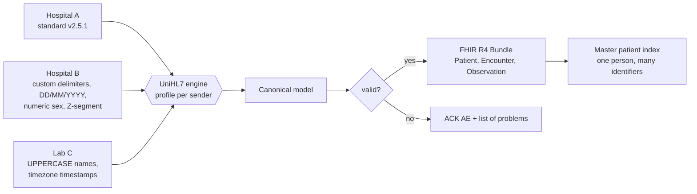

# UniHL7

**One canonical model for many HL7 v2 dialects, with real-time delivery over MLLP.**

Hackathon idea, rebuilt: hospital and lab systems all "speak HL7 v2", but each writes it a little
differently, so every connection needs its own hard-coded interface. UniHL7 shows a different approach:
describe each sender in a small **profile** (`profiles.json`), and let one engine normalize every
message into a single canonical model, validate it, link the patient across systems, and output
**FHIR R4**.



## What the demo proves

The same fake patient arrives from three systems in three different formats:

| | Hospital A | Hospital B | Lab C |
|---|---|---|---|
| Delimiters | `\|` `^` | `#` `$` | `\|` `^` |
| Patient ID | PID-3 | PID-2 | PID-3 |
| Name | `Doe^Jane^Marie` | `Doe, Jane Marie` | `JANE MARIE DOE` |
| Birth date | `19900214` | `14/02/1990` | `19900214000000+0300` |
| Sex | `F` | `2` | `female` |
| National ID | PID-3 repetition typed NI | `ZPI-2` (Z-segment) | PID-19 |

UniHL7 turns all three into **one** canonical patient (Jane Doe, 1990-02-14, female) and **one**
FHIR Patient carrying all three identifiers. A fourth, broken message is rejected with every
problem listed, not half-converted.

## Real-time: MLLP

Real HL7 v2 interfaces usually run over TCP with MLLP framing, not HTTP. `mllp.py` implements the
listener, client and ACK handling:

```
python mllp.py demo            # starts a listener, sends the 4 samples, prints the ACKs
hospital_a_standard    -> MSA|AA|A001
hospital_b_custom      -> MSA|AA|B777
lab_c_results          -> MSA|AA|C555
hospital_b_bad         -> MSA|AE|B778|patient identifier missing (PID-2.1); date of birth ...
python mllp.py serve 2575      # run a real listener on port 2575
```

`AA` means accepted, `AE` means rejected, and the reason is returned to the sender.

## Adding a new system

Add a profile to `profiles.json`. No engine code changes:

```json
"CLINIC_D": {
  "match": {"MSH-4": "CLINIC_D"},
  "mrn": "PID-3.1", "mrn_authority": "PID-3.4", "national_id": "PID-19.1",
  "name": "PID-5", "name_format": "xpn",
  "dob": "PID-7", "dob_format": "hl7",
  "sex": "PID-8", "sex_map": {"M": "male", "F": "female"},
  "class_map": {"I": "I", "O": "O"}
}
```

## Run and test

```
python unihl7.py samples            # normalize the multi-dialect samples
python mllp.py demo                 # real-time demo
python -m unittest test_unihl7 -v   # 8 tests, including a live MLLP round trip
```

## Files

`unihl7.py` engine · `profiles.json` dialect profiles · `mllp.py` MLLP listener and client ·
`test_unihl7.py` tests

## Limits

ADT and ORU only; Patient, Encounter and Observation only. Patient matching uses national ID, then
name plus birth date, and is a teaching version of a master patient index (no fuzzy matching, no
persistence). Fake data only; not validated or secured for real patient data.
This is my own rebuild of the idea from a hackathon prototype I contributed to.
